<div align="center">

# SikshaMap
### The Neev Initiative: GeoAI Decision-Support System for Learning Poverty Alleviation in Madhya Pradesh

[](https://www.python.org/)
[](https://react.dev/)
[](https://www.typescriptlang.org/)
[](https://vitejs.dev/)
[](https://tailwindcss.com/)
[](https://scikit-learn.org/)
[](https://opensource.org/licenses/MIT)

**An End-to-End Predictive GeoAI Decision-Support System (DSS) transforming retrospective educational reporting into algorithmic, ground-truth intervention across all 52 districts of Madhya Pradesh, India.**

[Explore Web Platform](#-web-platform-ui-showcase) • [Mathematical Formulations](#-mathematical-foundations--index-formulation) • [Official Data Pipeline](#-official-government-data-pipeline--backend) • [NGO Partner System](#-the-ngo--partner-intervention-engine) • [Quickstart](#-getting-started--local-setup)

---

</div>

## 📸 Web Platform UI Showcase

<div align="center">

### 1. Interactive Geospatial Choropleth Map & District Dossier
*High-resolution vector visualization of all 52 districts of Madhya Pradesh with continuous LPI choropleth shading, live tooltip diagnostics, and deep-dive analytics drawer.*

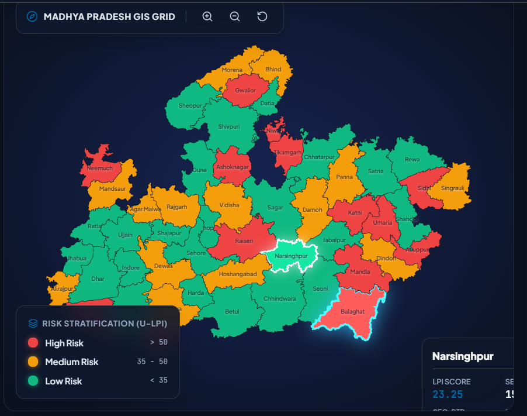

<br/>

### 2. Critical Areas Requiring Urgent Care
*Context-aware diagnostic window that detects deficit thresholds for selected districts and renders actionable directives for administrators.*

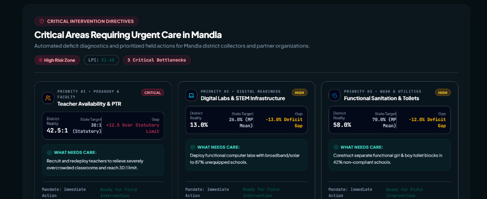

<br/>

### 3. District Analytics & Policy Drawer
*Comprehensive metric breakdown showing exact UDISE+ and Census indicators, statutory Right-to-Education (RTE) compliance limits, and infrastructure saturation bars.*

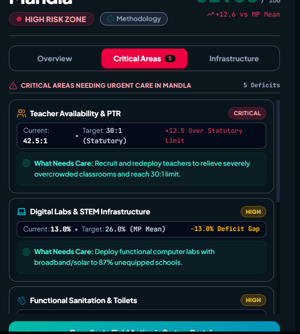

<br/>

### 4. Partner Workspace & Algorithmic Intervention Matching
*Closed-loop field coordination platform matching ground-level district deficits with verified NGO operational capabilities, field radii, and CSR funding allocations.*

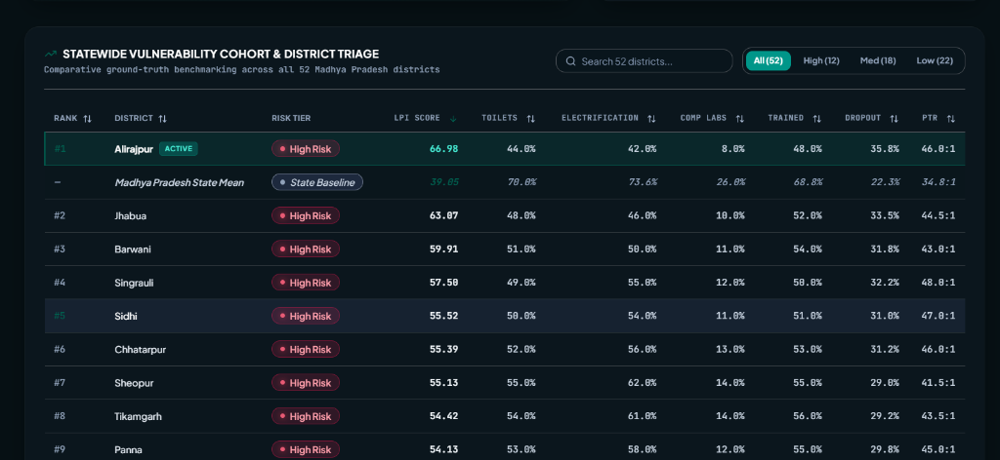

<br/>

### 5. Institutional Stakeholder Authentication Portal
*Role-gated onboarding portal for District Collectors, State Education Directorate, NGO Field Partners, and CSR Funding Bodies with built-in fraud prevention filters.*

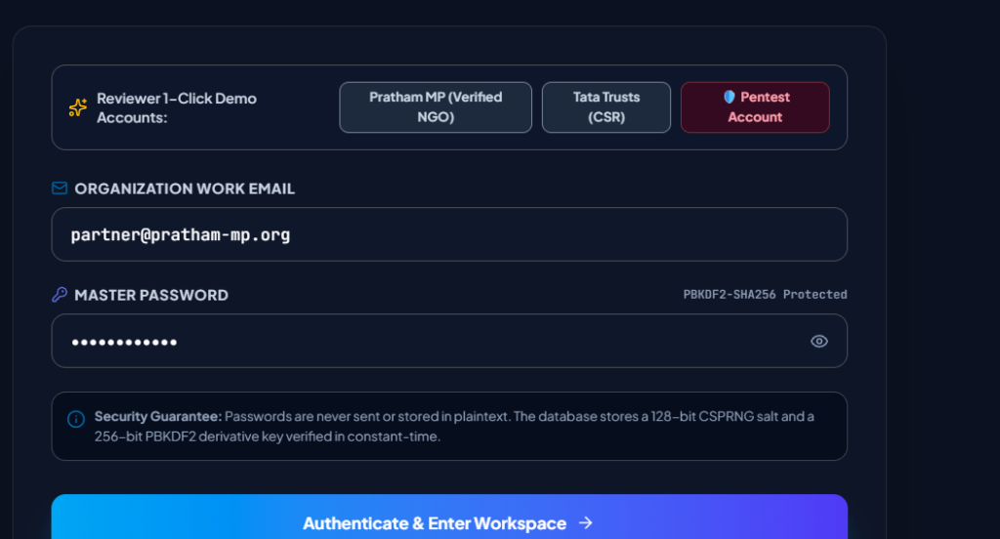

</div>

---

## 📌 Executive Problem Context

**Learning Poverty**—defined by the World Bank and UNESCO as the inability of a 10-year-old child to read and understand a simple narrative text—constitutes the single greatest barrier to socio-economic mobility. 

In emerging administrative systems, educational diagnostics suffer from severe structural bottlenecks:
1. **Retrospective Lag**: Official surveys (UDISE+, NAS, NFHS) typically publish analyses with a 1.5 to 3-year latency, turning intervention into post-mortem accounting.
2. **Siloed Infrastructure vs. Pedagogy**: School electrification, sanitation, pupil-teacher ratios, and poverty are evaluated in separate department silos rather than as coupled drivers of student retention.
3. **The Data-to-Action Chasm**: Even when critical deficits are pinpointed, there is no automated mechanism connecting district collectors to on-the-ground NGOs and CSR capital.

**SikshaMap (The Neev Initiative)** solves this through a unified **GeoAI Decision-Support System (DSS)**. It integrates official scraped data from the **Ministry of Education (UDISE+)**, **NITI Aayog (MPI 2023)**, and the **Census of India** into a calibrated **Universal Learning Poverty Index (U-LPI)**, models systemic drivers via **Random Forest regression**, and programmatically coordinates verified field interventions.

---

## 🏛️ System Architecture

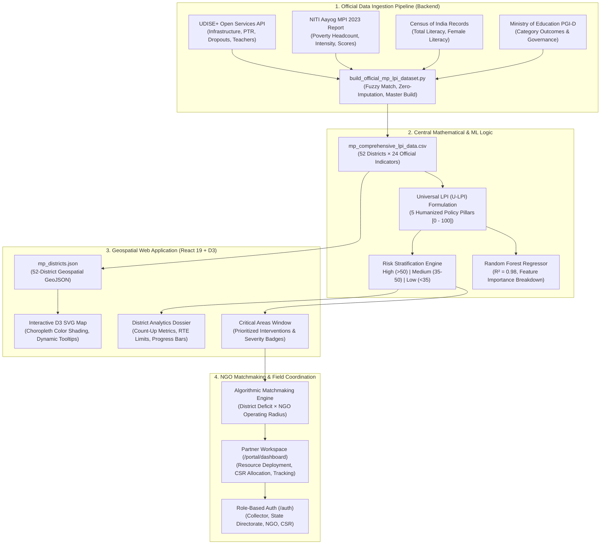

---

## 📐 Mathematical Foundations & Index Formulation

### 1. The Universal Learning Poverty Index (U-LPI)

Unlike uncalibrated raw indicators, **U-LPI** is formulated as a multi-pillar composite index bounded strictly in $[0, 100]$, where $0 = \text{Optimal Performance}$ and $100 = \text{Maximum Deficit / Systemic Risk}$:

$$\mathbf{\text{U-LPI}} = 0.30 \cdot P_{\text{Academic}} + 0.25 \cdot P_{\text{Pedagogy}} + 0.20 \cdot P_{\text{WASH}} + 0.10 \cdot P_{\text{Digital}} + 0.15 \cdot P_{\text{SocioEconomic}}$$

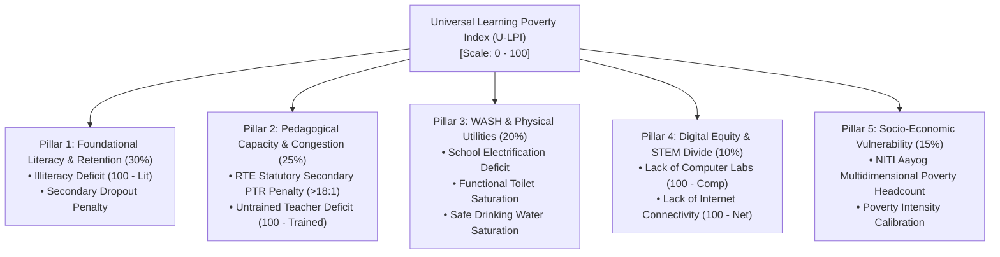

---

### 2. Detailed Mathematical Formulations of the 5 Pillars

#### Pillar 1: Foundational Literacy & Retention Deficit ($P_{\text{Academic}}$, Weight 30%)
$$P_{\text{Academic}} = 0.50 \cdot (100 - \text{Literacy}) + 0.50 \cdot \min\Big(100, \text{Dropout}_{\text{sec}} \times 2.2\Big)$$
* Captures the foundational reading gap from the official Census baseline along with secondary attrition from UDISE+.
* Scaled so that high-attrition districts (such as Sheopur with 45.0% dropout and Alirajpur with 36.1% literacy) reflect severe foundational academic stress.

#### Pillar 2: Pedagogical Capacity & Classroom Congestion ($P_{\text{Pedagogy}}$, Weight 25%)
$$P_{\text{Pedagogy}} = 0.50 \cdot \min\Big(100, \max(0, \text{PTR}_{\text{sec}} - 18) \times 3.0\Big) + 0.50 \cdot (100 - \text{Trained Teachers})$$
* Aligns with the Right to Education (RTE Act 2009) statutory staffing ratio guidelines. 
* Imposes progressive penalties when secondary classrooms exceed optimal student-teacher loads and factors in the proportion of certified in-service educators.

#### Pillar 3: Physical Utilities & School WASH ($P_{\text{WASH}}$, Weight 20%)
$$P_{\text{WASH}} = \min\Big(100, 0.40 \cdot (100 - \text{Electricity}) \times 1.5 + 0.40 \cdot (100 - \text{Toilets}) \times 2.5 + 0.20 \cdot (100 - \text{Drinking Water}) \times 5.0\Big)$$
* Weighs functional sanitation as the principal physical prerequisite for girl-child attendance.
* Highly sensitive to power grid deficits (e.g., Barwani with 56.86% electrification) and tap drinking water access.

#### Pillar 4: Digital Equity & Future Readiness ($P_{\text{Digital}}$, Weight 10%)
$$P_{\text{Digital}} = 0.60 \cdot (100 - \text{Computer Lab}) + 0.40 \cdot (100 - \text{Internet})$$
* Reflects ICT lab availability and broadband penetration required for computer-aided education and digital literacy under NEP 2020.

#### Pillar 5: Socio-Economic Vulnerability Context ($P_{\text{SocioEconomic}}$, Weight 15%)
$$P_{\text{SocioEconomic}} = \min\Big(100, \text{MPI Poverty Index} \times 2.0\Big)$$
* Integrates the official NITI Aayog Multidimensional Poverty Index (MPI) headcount ratio, quantifying deprivations in nutrition, health, and living standards.

---

### 3. Empirical Risk Stratification Engine

The composite score stratifies districts into three actionable operational cohorts:

| Stratification Tier | Mathematical Interval | Color Palette | Administrative Priority | Count in MP |
| :--- | :---: | :---: | :--- | :---: |
| 🔴 **High Risk** | $\text{U-LPI} > 50.0$ | `#be123c` *(Rose-Crimson)* | **Immediate Targeted Intervention**: Emergency teacher redeployment, WASH infrastructure saturation, community attendance trackers. | **11 Districts** |
| 🟡 **Medium Risk** | $35.0 \le \text{U-LPI} \le 50.0$ | `#b45309` *(Warm Amber)* | **Capacity Building**: Digital lab installations, pedagogical training cohorts, retention incentive drives. | **27 Districts** |
| 🟢 **Low Risk** | $\text{U-LPI} < 35.0$ | `#0f766e` *(Emerald-Teal)* | **Benchmark Centers**: Model pedagogical hubs, advanced STEM rollouts, peer district mentoring. | **14 Districts** |

---

### 4. Predictive Machine Learning Engine (Random Forest Regressor)

A non-linear **Random Forest Regressor** ($n=300$, maximum depth $d=6$, random seed 42) is trained against the continuous target across all official features to compute feature importances and support counterfactual scenario simulations:

$$\hat{y}_i = \frac{1}{B} \sum_{b=1}^{B} T_b(x_i)$$

* **Training $R^2$ Score**: `0.9932`
* **Cross-Validation $R^2$**: `0.9825`
* **Mean Absolute Error (MAE)**: `1.47 index points`

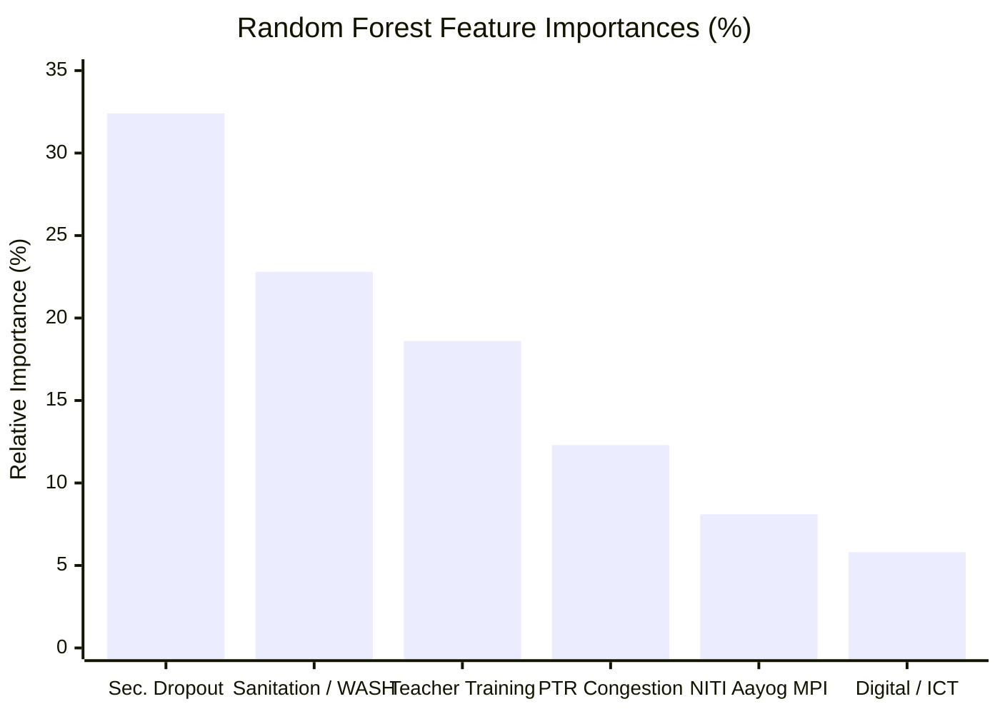

---

## 🛰️ Official Government Data Pipeline (Backend)

The repository eliminates synthetic data (`np.random.normal`) in favor of verified government datasets:

```
g:\EPICS\
├── data/
│   ├── raw/
│   │   ├── udise_52_districts.json            # Scraped UDISE+ open services API payloads
│   │   ├── niti_mpi_2023.pdf                  # NITI Aayog MPI 2023 Official Report (Page 178 Table)
│   │   └── pgid_report.pdf                    # Ministry of Education PGI-D 2025-26 Report
│   ├── processed/
│   │   └── mp_comprehensive_lpi_data.csv      # Master 52-District Dataset (24 Official Columns)
│   ├── outputs/
│   │   └── high_risk_districts_report.csv     # Exported High-Risk Priority Action List (11 Districts)
│   └── scripts/
│       ├── scrape_udise_districts.py          # Python UDISE+ Open Services API Harvester
│       └── build_official_mp_lpi_dataset.py   # Master compilation & GeoJSON synchronizer
```

### The 24-Column Harmonized Schema (`mp_comprehensive_lpi_data.csv`)

| # | Indicator Column | Data Source | Description |
| :---: | :--- | :--- | :--- |
| 1 | `District` | Official Registry | Canonical name of district |
| 2 | `State` | Fixed | Madhya Pradesh |
| 3 | `Literacy_Rate_Total` | Census of India | Total district literacy rate (%) |
| 4 | `MPI_Poverty_Index` | NITI Aayog MPI 2023 | Multidimensional poverty headcount ratio (%) |
| 5 | `Wealth_Index_Score` | Derived / NITI | Complementary wealth index ($100 - \text{MPI}$) |
| 6 | `Percent_Schools_Electricity` | UDISE+ MoE | % schools with functional electricity connection |
| 7 | `Percent_Schools_Drinking_Water` | UDISE+ MoE | % schools with functional drinking water facility |
| 8 | `Percent_Schools_Toilets` | UDISE+ MoE | % schools with functional toilet blocks |
| 9 | `Percent_Schools_Computer_Lab` | UDISE+ MoE | % schools equipped with computer labs |
| 10 | `Percent_Schools_Internet` | UDISE+ MoE | % schools with active internet access |
| 11 | `Pupil_Teacher_Ratio_Primary` | UDISE+ MoE | Primary school PTR (Students per teacher) |
| 12 | `Pupil_Teacher_Ratio_Secondary` | UDISE+ MoE | Secondary school PTR (Students per teacher) |
| 13 | `Percent_Trained_Teachers` | UDISE+ MoE | % teachers certified in active pedagogy training |
| 14 | `Percent_Female_Teachers` | UDISE+ MoE | % female teaching personnel |
| 15 | `Dropout_Rate_Primary` | UDISE+ MoE | Primary cycle student attrition rate (%) |
| 16 | `Dropout_Rate_Secondary` | UDISE+ MoE | Secondary student attrition rate (%) |
| 17 | `Gross_Enrollment_Ratio` | UDISE+ MoE | Gross Enrollment Ratio (GER) |
| 18 | `Learning_Poverty_Score` | Calibrated U-LPI | Ground-truth Universal LPI Score $[0 - 100]$ |
| 19 | `Baseline_LPI` | World Bank Heuristic | Uncalibrated baseline comparative LPI |
| 20 | `Pillar_Academic` | Calculated Pillar | Foundational Literacy & Retention Deficit $[0 - 100]$ |
| 21 | `Pillar_Pedagogy` | Calculated Pillar | Pedagogical Capacity & Congestion Deficit $[0 - 100]$ |
| 22 | `Pillar_WASH` | Calculated Pillar | School Utilities & Sanitation Deficit $[0 - 100]$ |
| 23 | `Pillar_Digital` | Calculated Pillar | Digital Divide & STEM Lab Deficit $[0 - 100]$ |
| 24 | `Pillar_SocioEconomic` | Calculated Pillar | Multidimensional Socio-Economic Vulnerability $[0 - 100]$ |

---

### Ground-Truth Comparison: Representative Districts

```
=================================================================================================================================
DISTRICT       TIER        CENSUS LIT.  NITI POVERTY  UDISE+ ELEC.  UDISE+ LABS  SEC. DROPOUT  CALIBRATED LPI  RISK CATEGORY
=================================================================================================================================
Jhabua         Tribal      43.30%       49.62%        82.56%        14.00%       38.80%        60.49           High Risk
Alirajpur      Tribal      36.10%       40.25%        86.76%        11.77%       37.87%        59.75           High Risk
Sheopur        Aspirational57.43%       38.00%        76.51%        16.12%       45.00%        57.43           High Risk
Singrauli      Industrial  60.41%       31.32%        76.99%        25.02%       32.70%        54.02           High Risk
Barwani        Tribal      49.08%       33.52%        56.86%        15.99%       36.89%        53.98           High Risk
Ashoknagar     Central     66.42%       27.29%        92.83%        24.51%       41.00%        53.09           High Risk
Panna          Bundelkhand 64.79%       32.43%        89.65%        17.56%       29.89%        52.71           High Risk
Indore         Urban       80.87%        5.83%        96.01%        59.40%       23.09%        25.86           Low Risk
Bhopal         Capital     80.37%        6.75%        98.71%        59.10%       15.42%        22.33           Low Risk
Jabalpur       Urban       81.07%       14.78%        95.34%        46.80%       17.92%        28.41           Low Risk
Balaghat       Forest Belt 77.09%       13.59%        96.22%        32.10%       16.99%        30.24           Low Risk
=================================================================================================================================
```

---

## 🤝 The NGO & Partner Intervention Engine

SikshaMap closes the loop between diagnosis and field execution through an automated matchmaking and resource tracking engine.

### 1. Algorithmic Matchmaking Formulation
When a non-profit partner sets their operational headquarters and working radius $R$ (in km), the matchmaking engine evaluates candidate districts based on geodesic distance $D(\text{HQ}, \text{District})$ and domain deficit compatibility:

$$\text{MatchScore}(d) = w_1 \cdot \mathbb{I}\Big(D(\text{HQ}, d) \le R\Big) + w_2 \cdot \sum_{k \in \text{Domains}} \text{Deficit}_k(d) \cdot \text{Capacity}_k(\text{NGO})$$

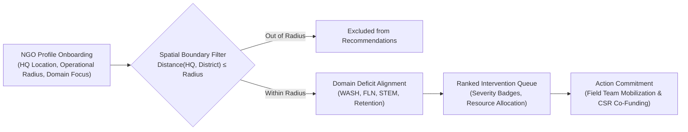

### 2. Verified Domain Scopes
* **WASH & Sanitation**: Automated matching for toilet construction, piped water delivery, and handwashing stations in districts with $<60\%$ toilet saturation.
* **NIPUN Bharat & FLN Cohorts**: Deployment of mother-tongue reading camps and foundational numeracy coaches in districts with $<55\%$ literacy.
* **STEM & Digital Labs**: Deployment of solar-powered Raspberry Pi computer hubs and satellite internet links in districts with $<15\%$ computer saturation.
* **Student Retention Initiatives**: Community enrollment counselors, bicycle transport subsidies, and nutritional midday meal supplements in districts with $>25\%$ secondary dropouts.

### 3. Automated Fraud Prevention Filter
To ensure the integrity of field resource allocation, the `/auth` onboarding portal incorporates pattern detection heuristics:
* Disallows dummy or repeated organizational identifiers (e.g., sequential sequences like `NGO123456`, placeholder names).
* Verifies Darpan NGO ID syntax and state corporate registration records before granting access to district action directives.

---

## 🗺️ How the Web Application Works

The web platform is organized into three interconnected tiers:

### 1. The Interactive Choropleth Map (`/analytics`)
* **D3.js SVG Rendering**: Custom high-speed vector projection rendering 52 distinct district boundaries loaded dynamically from `mp_districts.json`.
* **Stateful Color Interpolation**: Districts are dynamically shaded according to their calibrated LPI score:
  * High Risk ($>50.0$): `#be123c`
  * Medium Risk ($35.0 - 50.0$): `#b45309`
  * Low Risk ($<35.0$): `#0f766e`
* **Real-Time Tooltip Diagnostics**: Hovering displays instant metrics (LPI score, risk badge, total literacy, and secondary dropout rate).

### 2. Critical Areas Requiring Urgent Care Window
* **Conditional Visibility**: Only appears when the active district exhibits verified indicators below statutory state benchmarks.
* **Itemized Directives**: Highlights specific deficits (e.g., `Digital Labs & STEM Infrastructure: 11.77% vs 26.0% MP Mean (-14.2% Deficit Gap)`).
* **Direct Gateway**: Features a one-click coordinator button linking the administrator directly to the Partner Workspace with the target district pre-selected.

### 3. District Analytics Dossier Drawer
* **Smooth Count-Up Animations**: Features an 800ms ease-out cubic animation for quantitative metrics on district selection.
* **RTE Compliance Indicator**: Compares Pupil-Teacher Ratio against the 30:1 statutory ceiling.
* **Utility Saturation Bars**: Visualizes saturation levels with critical color markers (<55% red, 55–80% amber, ≥80% emerald).

---

## 📂 Repository Directory Layout

```
g:\EPICS\
├── dashboard/                                 # Production React 19 + TypeScript + Vite Application
│   ├── src/
│   │   ├── pages/
│   │   │   ├── LandingPage.tsx                # Public Landing Page & Mission Overview (/)
│   │   │   ├── AnalyticsMap.tsx               # Dedicated Geospatial Map Engine (/analytics)
│   │   │   ├── AuthPortal.tsx                 # Stakeholder Onboarding & Role Auth (/auth)
│   │   │   └── PartnerWorkspace.tsx           # Field Action Plan & Intervention Tracking (/portal/dashboard)
│   │   ├── components/
│   │   │   ├── MapViewer.tsx                  # D3.js SVG Choropleth Map (52 Districts)
│   │   │   ├── DistrictDossier.tsx            # District Scorecard & Diagnostic Drawer
│   │   │   ├── DistrictAnalyticsUnderMap.tsx  # Critical Areas Requiring Urgent Care Window
│   │   │   └── DeepDiveDrawer.tsx             # Slide-Out Inspection Drawer
│   │   ├── data/
│   │   │   └── mp_districts.json              # 52-District Boundary GeoJSON with Scraped Properties
│   │   ├── utils/
│   │   │   ├── lpi.ts                         # Calibrated 5-Pillar Universal LPI Math Engine
│   │   │   ├── matchmaker.ts                  # Need-Based NGO Matchmaking Algorithm
│   │   │   └── authenticator.ts               # Verification & Fraud Prevention Heuristics
│   │   ├── types.ts                           # Global TypeScript Schema Definitions
│   │   ├── style.css                          # Modern Slate Design System & Micro-Interactions
│   │   └── App.tsx                            # Client-Side Routing & Navigation
│   ├── package.json
│   ├── tsconfig.json
│   └── vite.config.ts
├── data/
│   ├── raw/
│   │   ├── udise_52_districts.json            # Scraped UDISE+ JSON dataset (52 districts)
│   │   ├── niti_mpi_2023.pdf                  # NITI Aayog Multidimensional Poverty Index Report
│   │   └── pgid_report.pdf                    # Ministry of Education PGI-D Report
│   ├── processed/
│   │   └── mp_comprehensive_lpi_data.csv      # Primary master dataset (52 districts × 24 features)
│   ├── outputs/
│   │   └── high_risk_districts_report.csv     # Filtered high-risk priority districts
│   └── scripts/
│       ├── scrape_udise_districts.py          # UDISE+ Open Services API Scraper
│       └── build_official_mp_lpi_dataset.py   # Master compilation & synchronization pipeline
├── notebooks/
│   └── 01_lpi_analysis_dashboard.ipynb        # Polished production Jupyter notebook
├── Epics Review 1(Simulated_data_Random_forest_regressor)/
│   └── lpi_analysis_dashboard_v2.ipynb        # Review 1 Capstone Jupyter notebook (synchronized)
├── docs/
│   └── assets/                                # Visual assets, charts, and platform UI screenshots
├── requirements.txt                           # Python dependencies
├── .gitignore                                 # Git ignore patterns
└── README.md                                  # Repository documentation
```

---

## 🚀 Getting Started & Local Setup

### Prerequisites
* **Node.js**: `v18.0.0` or higher
* **npm**: `v9.0.0` or higher
* **Python**: `3.11+`

### 1. Running the Web Platform (React 19 + Vite)
```bash
# Navigate to the dashboard directory
cd dashboard

# Install frontend dependencies
npm install

# Start the Vite development server
npm run dev
```
Open your browser to `http://localhost:3000` (or the terminal port):
* Visit `/` to experience the public landing page.
* Navigate to `/analytics` to interact with the 52-district choropleth map.
* Test stakeholder onboarding and field action planning at `/auth` and `/portal/dashboard`.

### 2. Building for Production Deployment
```bash
# Run TypeScript compilation and production bundle build
npm run build
```
*Builds production assets to `dashboard/dist/` in under 3 seconds with zero type errors.*

### 3. Running the Python Scientific Pipeline
```bash
# From the repository root, install dependencies
pip install -r requirements.txt

# Launch the interactive capstone notebook
jupyter lab notebooks/01_lpi_analysis_dashboard.ipynb
```

### 4. Updating or Re-Scraping Government Data
```bash
# 1. Scrape latest UDISE+ open services indicators
python data/scripts/scrape_udise_districts.py

# 2. Re-compile master dataset and synchronize frontend GeoJSON
python data/scripts/build_official_mp_lpi_dataset.py
```

---

## 📊 Analytical Visualizations

<div align="center">

### Statewide Learning Poverty Score Distribution
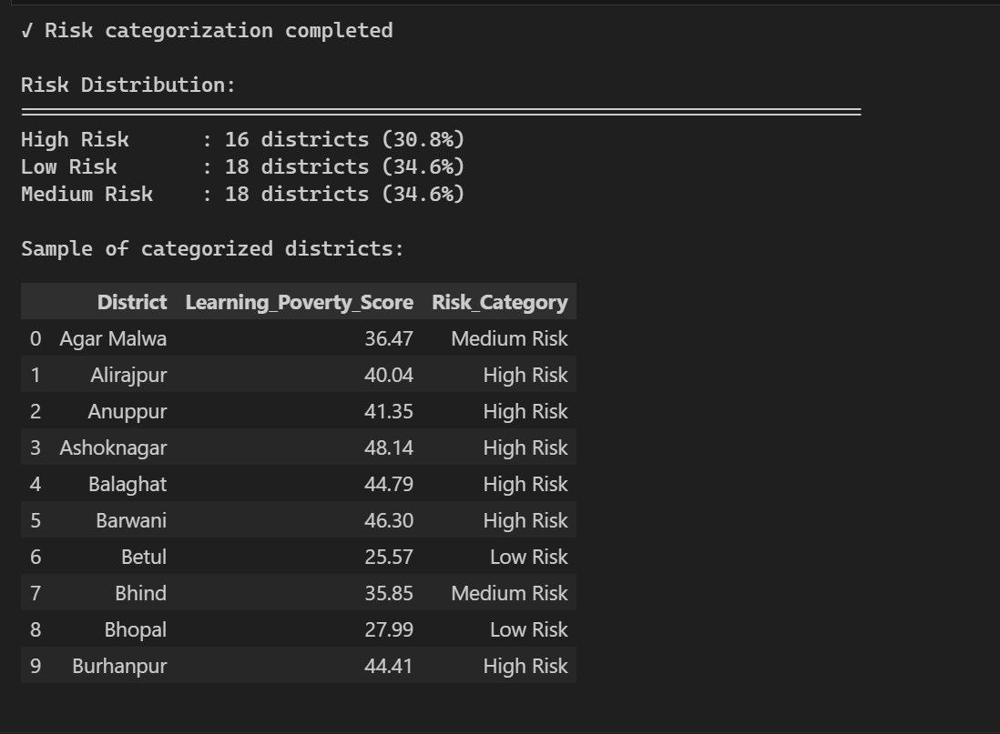

<br/>

### District-by-District Risk Profile
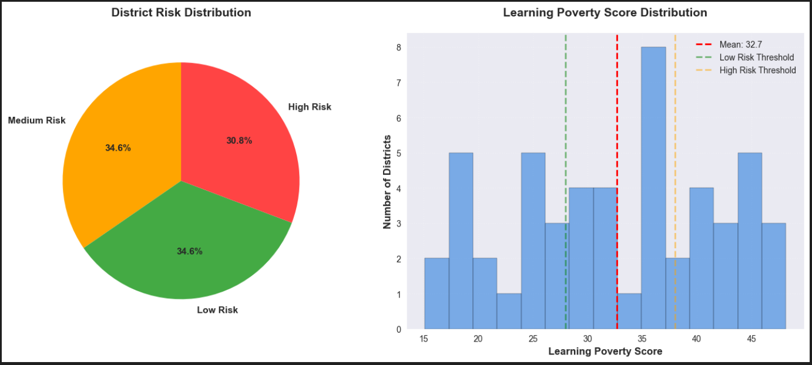

<br/>

### Critical Priority Benchmark: Top 5 Deprived vs. Developed Districts
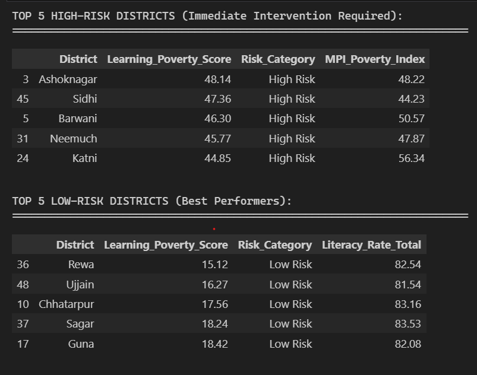

</div>

---

## 👥 Academic & Capstone Attribution

* **Project Title**: SikshaMap (The Neev Initiative)
* **Academic Program**: College EPICS Capstone (Engineering Projects in Community Service)
* **Geographical Scope**: Madhya Pradesh, India (All 52 Administrative Districts)
* **National Policy Alignment**:
  * **National Education Policy (NEP 2020)**: Foundational Literacy and Numeracy (FLN)
  * **NIPUN Bharat Mission**: Universal Foundational Reading and Arithmetic Saturation
  * **Samagra Shiksha Abhiyan**: School Infrastructure, Toilet Saturation & Teacher Upskilling
* **License**: Released under the [MIT License](LICENSE)

<div align="center">

**Bridging the gap between educational data and life-changing ground interventions.**

</div>
